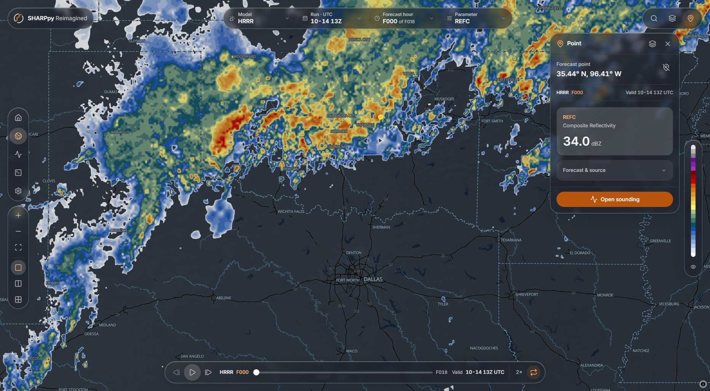
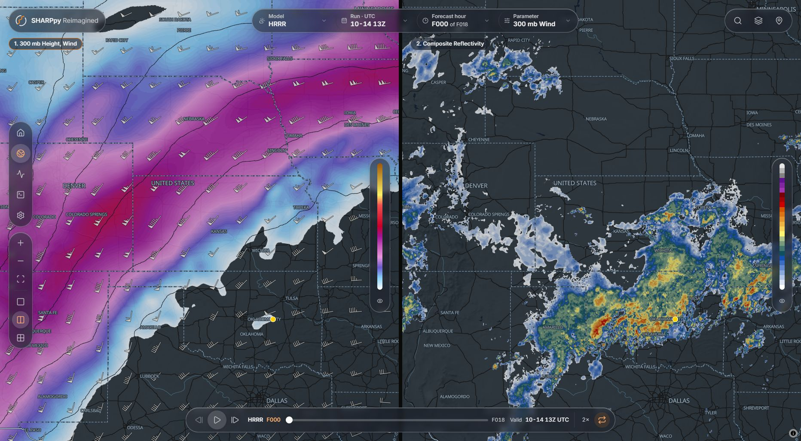
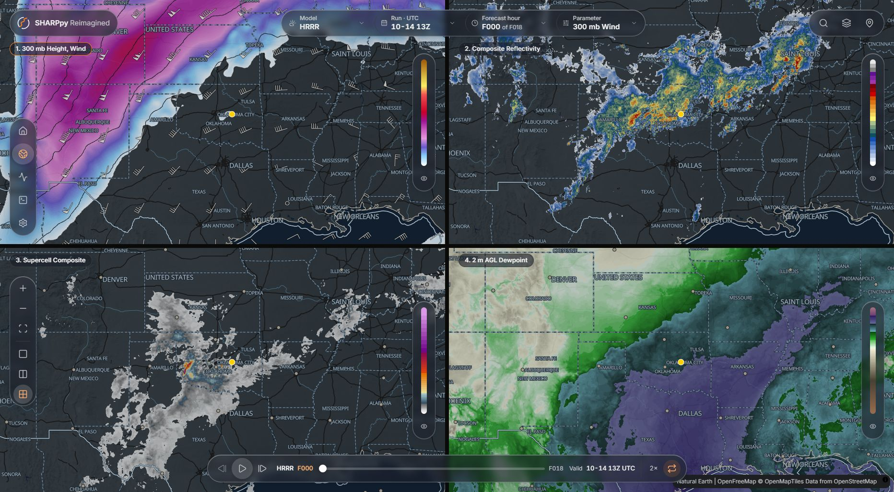
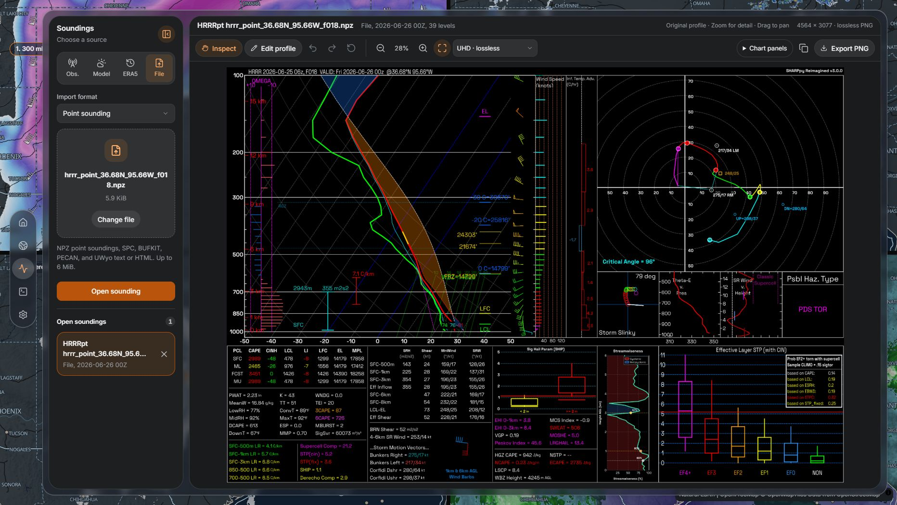
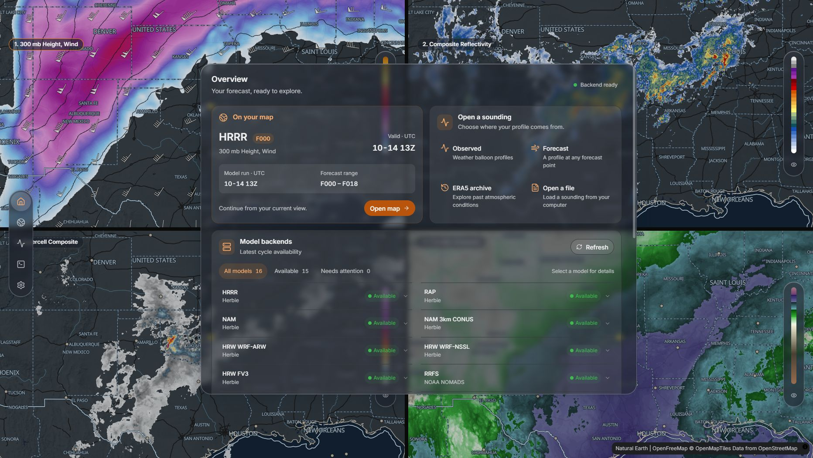
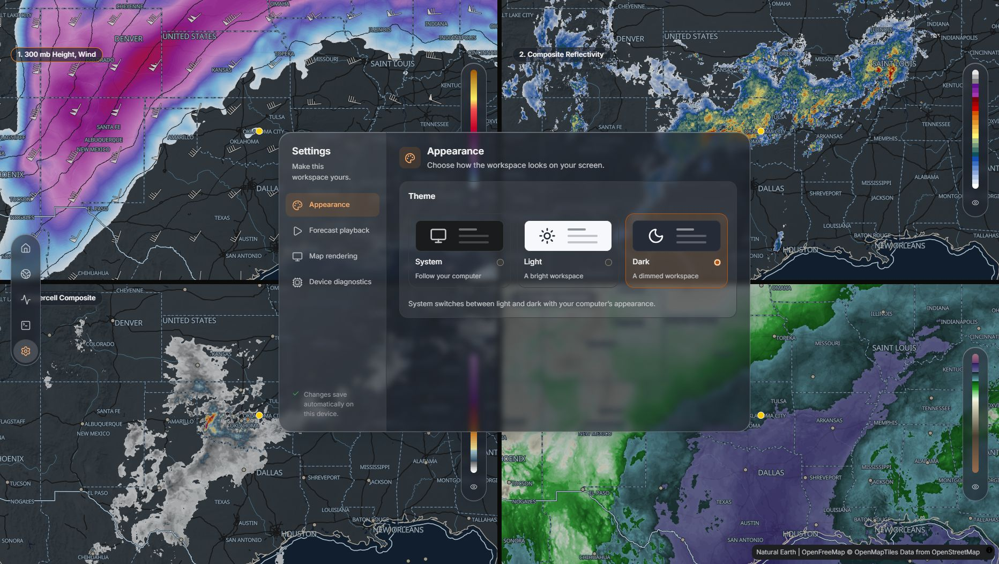

# SHARPpy Reimagined

**Severe-weather soundings, forecast fields, and maps in one desktop workspace.**

[Explore the app](#explore-the-app) · [Get started](#get-started) · [User guide](docs/USAGE.md) · [Downloads](https://github.com/ShianMike/SHARPpy-Reimagined/releases)

## What's new in 3.0.1

SHARPpy Reimagined brings [SHARPpy](https://github.com/sharppy/SHARPpy) sounding analysis into a map-based desktop workspace. Version **3.0.0** introduces a React/Tauri interface backed by the existing Python and Rust scientific tools. This README describes that interface; the [v2.0.0 Legacy tour and screenshots](https://github.com/ShianMike/SHARPpy-Reimagined/blob/v2.0.0/README.md) document the previous GUI.

The **3.0.1 patch** adds signed in-app updates, a fullscreen control, a minimum window size of 1280 × 800, and clearer outlook tooltips and notices. Its release page retains the **v3.0.0** title; the installer and update feed use **3.0.1** so future updates can detect newer builds.

## Explore the app

Use the navigation rail to move between five workspaces:

| Workspace | What you can do |
| --- | --- |
| **Overview** | Start a forecast or sounding workflow and check the backend status. |
| **Model Viewer** | Explore forecast fields in one, two, or four synchronized maps; inspect a point and open its sounding. |
| **Soundings** | Fetch observed, forecast-model, or ERA5 profiles, or import local files; inspect and edit the Skew-T and hodograph. |
| **Logs** | Inspect backend health, capabilities, and diagnostic messages when a request fails. |
| **Settings** | Adjust appearance, forecast playback, map rendering, and device-specific graphics settings. |

### v3.0.0 tour

These **v3 development-interface screenshots** were captured from the live
browser preview at its native viewport size, **1864 pixels wide**. Click an image for its original pixels.
The maps use **HRRR 14 October 2026, 13Z, F000**. The sounding is the bundled
**25 June 06Z, F018** profile, valid **26 June 00Z**; it shows a different case.
[Capture details](docs/images/v3.0.0/README.md).

<strong>Model Viewer · forecast field and point inspector</strong>

Select a point to read its value and source, then open its sounding.

<strong>Two panels · upper-air winds beside reflectivity</strong>

Compare products at the same forecast time with synchronized map movement.

<strong>Four panels · independent products and scales</strong>

Each panel keeps its own layers and a scale positioned within that panel.

<strong>Soundings · local import, Skew-T, hodograph, and editing controls</strong>

The NPZ was imported through the File form and rendered at UHD resolution.
Inspect or edit the profile, then copy or export the image.

<strong>Overview · forecast context and model availability</strong>

Resume the map or start an observed, model, ERA5, or local-file sounding.
Provider availability is a snapshot of the capture session.

<strong>Settings · appearance, playback, rendering, and diagnostics</strong>

Preferences save on the current device.

### Weather maps

Choose a model, UTC run, forecast hour, and parameter from the floating toolbar. The timeline steps through available forecast hours, with playback speed and looping controls.

Two- and four-panel layouts share the map view and forecast time while keeping each panel's parameter, layers, and colour range. Their settings return when you reopen a layout. Hover over a model field to read its value; select a point for details and **Open sounding**.

Smooth rendering is the default, with a Sharp option available. Station labels start off when the app opens. Layers include SPC outlooks, radar, satellite imagery, surface observations, and storm reports. Wind barbs adapt their density to the zoom level. Model menus show the parameters supported by each model, including RRFS, NAM 3 km, and REFS members.

### Soundings and local imports

The **Soundings** workspace has **Obs.**, **Model**, **ERA5**, and **File** sources. Open NPZ point soundings, SPC, BUFKIT, PECAN, and UWyo text or saved HTML files up to **6 MiB**.

For raw WRF-ARW output, choose **File → Import format → Raw WRF dataset**, paste the full local path to the `wrfout`/NetCDF file, and click **Read WRF file**. Select a UTC forecast time and a point within its grid, then **Open WRF sounding**. The dataset stays on disk while the backend extracts the selected column.

Use **Inspect** to pan and zoom the sounding, or **Edit profile** to change a selected level. Undo, redo, and reset let you review edits without overwriting the input file. Choose HD or UHD lossless output and copy or download the sounding image. See the [desktop guide](docs/USAGE.md#0-desktop-interface-v300) for the full workflow.

## Get started

### Windows downloads

Download the **v3.0.1 patch [Windows installer](https://github.com/ShianMike/SHARPpy-Reimagined/releases/download/v3.0.1/SHARPpy-Reimagined-v3.0.1-windows-x64-setup.exe)** or the [portable ZIP](https://github.com/ShianMike/SHARPpy-Reimagined/releases/download/v3.0.1/SHARPpy-Reimagined-v3.0.1-windows-x64.zip). Both include the app and its analysis backend; Python is bundled. Extract the complete portable folder before running the app. The executables are unsigned; [release notes, checksums, and build provenance](https://github.com/ShianMike/SHARPpy-Reimagined/releases/tag/v3.0.1) let you verify the download.

**v2.0.0 Legacy is the final PySide6/Qt GUI release.** Its [Windows ZIP](https://github.com/ShianMike/SHARPpy-Reimagined/releases/download/v2.0.0/SHARPpy-Reimagined-v2.0.0-windows-x64.zip) and [portable executable](https://github.com/ShianMike/SHARPpy-Reimagined/releases/download/v2.0.0/SHARPpy-Reimagined-v2.0.0-windows-x64-portable.exe) remain downloadable from the [legacy release page](https://github.com/ShianMike/SHARPpy-Reimagined/releases/tag/v2.0.0), including after v3 is released.

### Run v3 from source

Use Python **3.11–3.13**, Node.js **24.12 or newer**, a stable Rust toolchain, and your platform's Tauri build prerequisites. On Windows, run these commands from the repository root in PowerShell:

~~~powershell
py -3.11 -m venv .venv
.\.venv\Scripts\Activate.ps1
python scripts/install_sharppy_compat.py --extras era5,wrf,rust-build
sharpmod-rust-sync
Set-Location frontend
npm ci
npm run tauri -- dev
~~~

The compatibility installer verifies and installs the upstream SHARPpy render wheel. `sharpmod-rust-sync` builds the native scientific extension when needed. The development app discovers the repository's `.gribenv` or `.venv`; an explicit `SHARPPY_PYTHON` must be an absolute interpreter path.

For a live browser preview, run `npm run dev:browser` from `frontend/` and open `http://127.0.0.1:5174/`. For deterministic sample data, use `npm run dev:fixture` instead. See the [development guide](docs/frontend/ARCHITECTURE.md#running-the-interface) and [installation reference](installation.txt) for prerequisites and troubleshooting.

To render a saved sounding without the desktop, run:

~~~powershell
sharpmod-render examples/soundings/hrrr_point_36.68N_95.66W_f018.npz sounding.png
~~~

`sharpmod-gui` continues to start the legacy Qt interface from source. Start the v3 interface with the Tauri command above.

## Guides

- [Using the v3 desktop, local imports, and CLI](docs/USAGE.md)
- [Frontend development and architecture](docs/frontend/ARCHITECTURE.md)
- [Frontend commands and data contracts](docs/frontend/DATA_CONTRACTS.md)
- [Installation and optional dependencies](installation.txt)
- [Rust backend and Python fallback](docs/RUST_BACKEND.md)
- [Changes in 3.0.1](CHANGELOG.md#v301---2026-10-15)
- [Contributing and test lanes](CONTRIBUTING.md)
- [v2.0.0 Legacy usage guide](https://github.com/ShianMike/SHARPpy-Reimagined/blob/v2.0.0/docs/USAGE.md)

SHARPpy Reimagined is a fork of [SHARPpy](https://github.com/sharppy/SHARPpy) and is distributed under the [BSD 3-Clause License](LICENSE). Weather layers retain their provider and valid-time information in the interface.
