<div align="center">

# SHARPpy Reimagined · v3.5.1

**Forecast maps, live weather and sounding analysis in one desktop workspace.**

[](https://github.com/ShianMike/SHARPpy-Reimagined/actions/workflows/tests.yml)
[](https://github.com/ShianMike/SHARPpy-Reimagined/releases "Downloads of all release assets, including updater metadata")


[](LICENSE)

[Screenshots](#screenshots) · [Downloads](https://github.com/ShianMike/SHARPpy-Reimagined/releases) · [User guide](docs/USAGE.md) · [Changelog](CHANGELOG.md#v351---2026-10-30)

</div>

## What's new in 3.5.1

- **Faster first sounding display:** ECAPE now uses a native Rust workspace,
  reducing first-render delay and initial memory use while preserving scientific
  reference checks and missing-data behavior. In the recorded local UHD comparison,
  the first-render median improved from 5.15 s to 3.37 s with about 160 MiB less
  initial peak working set; repeated-render timings were essentially unchanged.

See the [measurement report](docs/performance/ECAPE_RUST_MIGRATION.md) for the
hardware, comparison method and limits. This patch also includes the public-updater
acceptance check for the existing install review.

### Included from 3.5.0

- **Australian radar:** search 67 sites and view MRRL Base Reflectivity or
  Doppler Velocity, with actual scan times and distinct range-folded values.
- **Updraft tracks:** view 1-hour and 3-hour maximum updraft helicity for
  2–5 km AGL on HRRR and supporting models, with a shared colour table.
- **Map details:** toggle OpenStreetMap roads per panel, read full storm-report
  hazard names and use consistent surface-station symbols.
- **Sounding controls:** pick sources and forecast times in compact glass
  popups, switch chart panels, and edit one level at a time with undo/redo.

This release includes the [Rust migration baseline](CHANGELOG.md#v342---rust-migration-baseline)
for downloads, live providers, map processing and sounding calculations.

## Weather analysis

- **Model Viewer:** compare forecast fields in one, two or four synchronized
  maps. Models are grouped into CONUS, Global and Regional, with NAM and RAP
  under Regional. Parameter choices follow the selected run's published fields.
- **More model coverage:** explore supported GFS, ECMWF, ECMWF 9km, NAM and HRW
  parameters. GDPS provides point soundings; AIGFS provides map analysis only.
- **Live Tracking:** follow radar, satellite imagery, surface observations,
  warnings and watches. Compare available radar products and tilts, inspect
  measured values and replay cached observations with their source times.
- **Soundings:** open observed, model or ERA5 profiles, or import local files.
  Inspect linked Skew-T and hodograph levels, edit a profile with undo/redo,
  and copy or export HD/UHD PNGs with edited-level annotations.

## Clearer controls

Find parameters by category or search, preview descriptions in a separate glass
card, and switch between navigation and point inspection beside playback.
Readable glass readouts follow saved temperature and wind units. Graphics
settings compare Automatic, Low, Balanced and High in one view.

Logs can copy a diagnostic summary with the operation, provider, time, error
category and recovery action, excluding credentials and raw request details.
Before an update installs, review which preferences and caches remain and which
open soundings, edits and history will be lost.

## Screenshots

Interface views from 3.5.0, captured at 1920 × 1080 from the live local application.
The v3.5.1 performance update retains this interface.
Open an image to view it at its original size.

<details open>
<summary><strong>Overview · forecast, live weather and sounding workflows</strong></summary>

[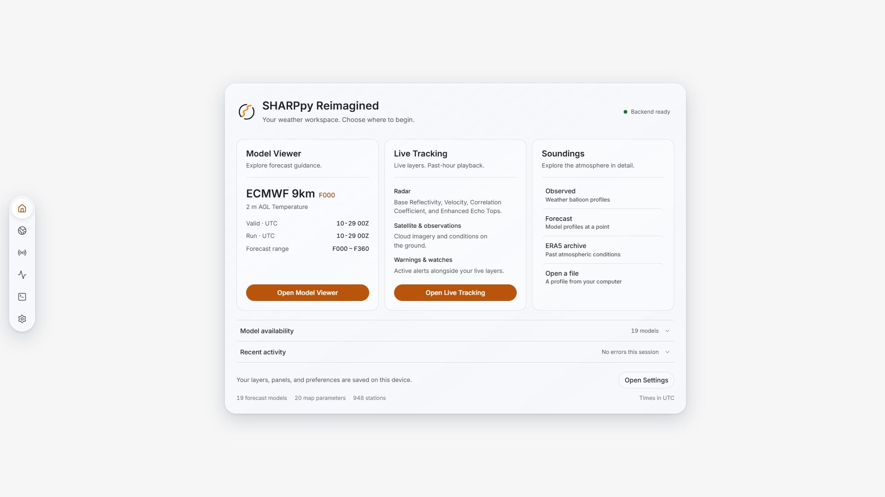](docs/images/v3.5.0/overview.jpg)

</details>

<details>
<summary><strong>Model Viewer · forecast fields and playback</strong></summary>

[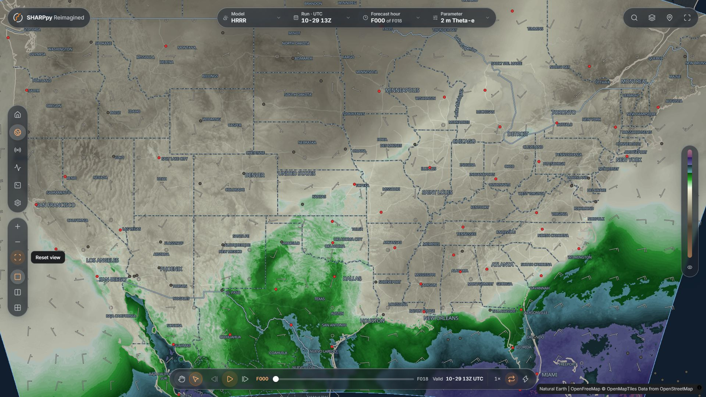](docs/images/v3.5.0/model-viewer.jpg)

</details>

<details>
<summary><strong>Two panels · synchronized forecast comparison</strong></summary>

[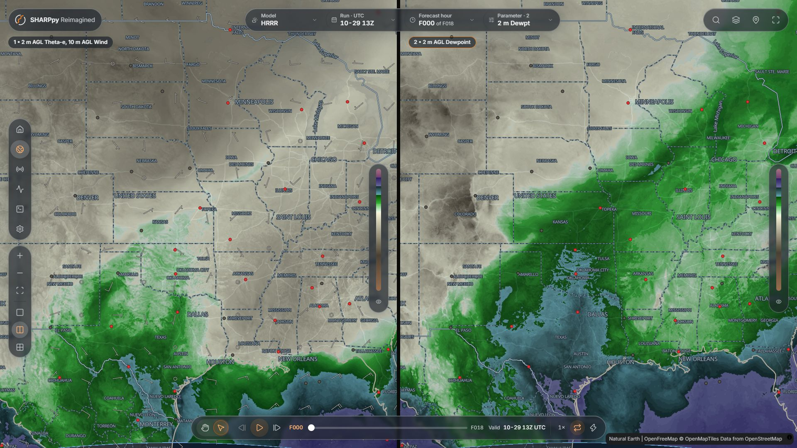](docs/images/v3.5.0/two-panels.jpg)

</details>

<details>
<summary><strong>Four panels · independent products and scales</strong></summary>

[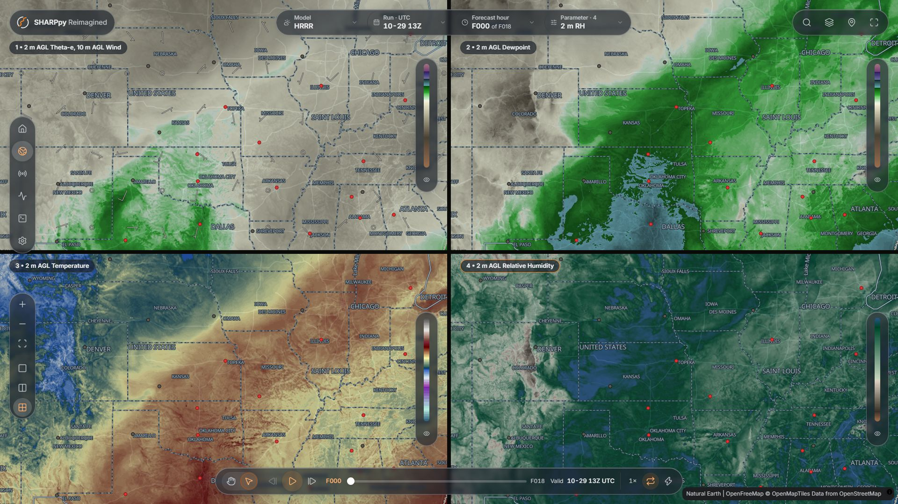](docs/images/v3.5.0/four-panels.jpg)

</details>

<details>
<summary><strong>Forecast downloads · saved hours and playback readiness</strong></summary>

[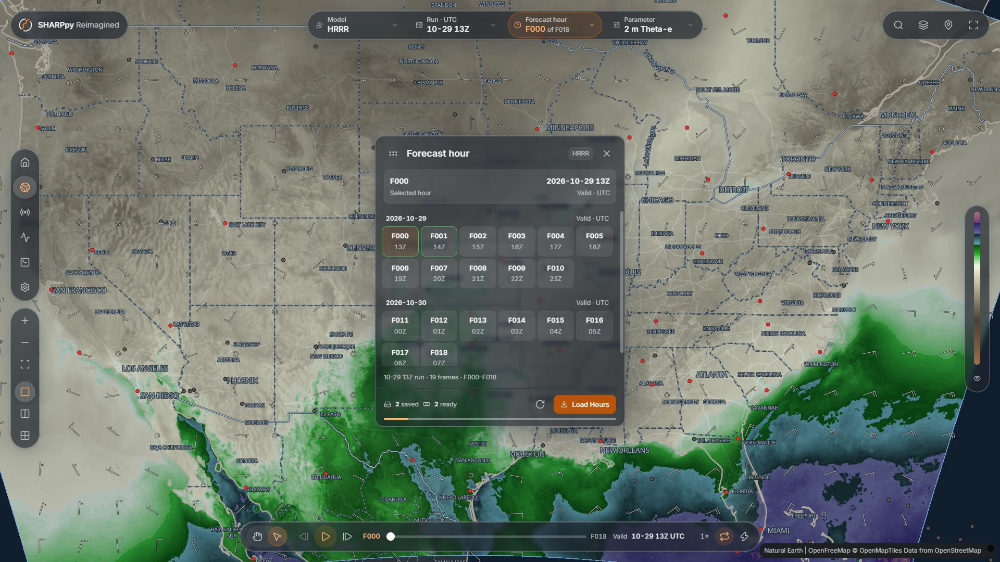](docs/images/v3.5.0/download-details.jpg)

</details>

<details>
<summary><strong>Live Tracking · radar products and measured values</strong></summary>

[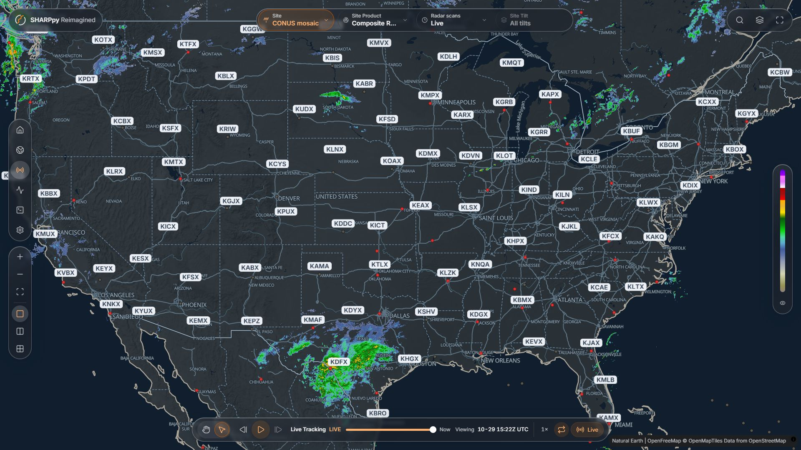](docs/images/v3.5.0/live-tracking.jpg)

</details>

<details>
<summary><strong>Soundings · Skew-T, hodograph and profile editing</strong></summary>

[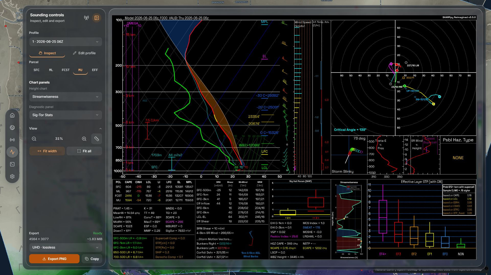](docs/images/v3.5.0/sounding.jpg)

</details>

<details>
<summary><strong>Settings · preferences and weather cache management</strong></summary>

[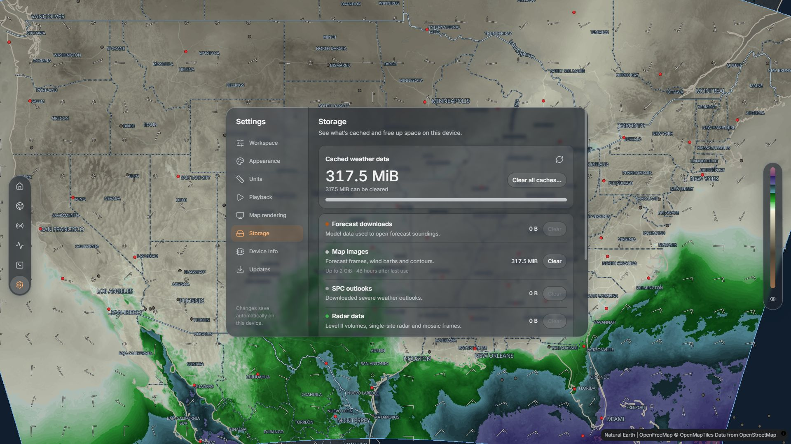](docs/images/v3.5.0/settings.jpg)

</details>

<details>
<summary><strong>Updates · release highlights</strong></summary>

[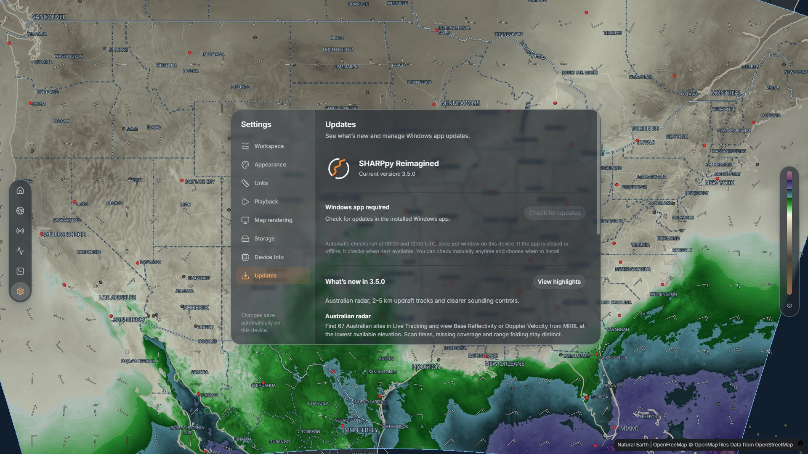](docs/images/v3.5.0/updates.jpg)

[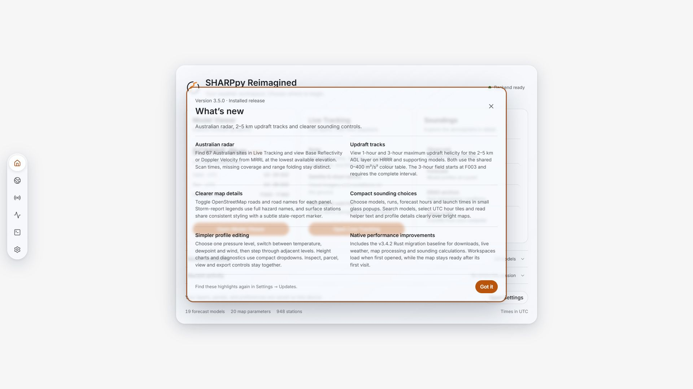](docs/images/v3.5.0/whats-new.jpg)

</details>

<details>
<summary><strong>Australian radar · native velocity and site selection</strong></summary>

[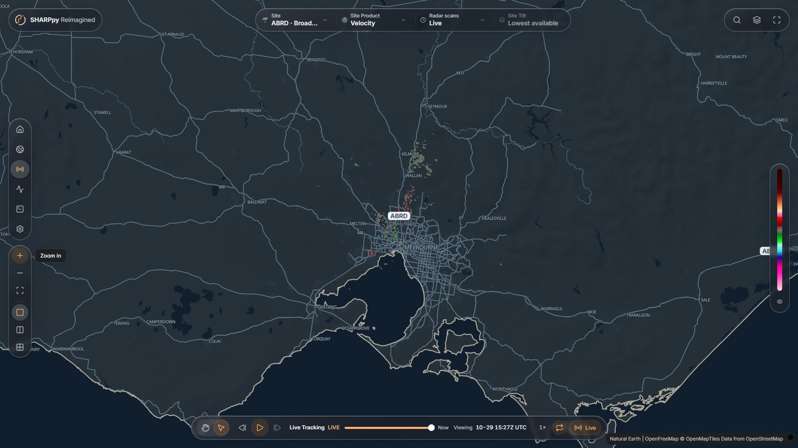](docs/images/v3.5.0/australian-radar.jpg)

</details>

## Get started

Windows installers and portable ZIPs are distributed through
[GitHub Releases](https://github.com/ShianMike/SHARPpy-Reimagined/releases).
Both include the analysis backend and Python. Extract the complete portable
folder before launching it. Existing installations can check **Settings →
Updates**. Release assets include checksums and build provenance; the Windows
executables are unsigned.

To run from source, use Python **3.11–3.13**, Node.js **24.12 or newer**, stable
Rust and your platform's Tauri prerequisites. From the repository root in
PowerShell:

```powershell
py -3.11 -m venv .venv
.\.venv\Scripts\Activate.ps1
python scripts/install_sharppy_compat.py --extras era5,wrf,rust-build
sharpmod-rust-sync
Set-Location frontend
npm ci
npm run tauri -- dev
```

For a live browser preview, run `npm run dev:browser` in `frontend/` and open
`http://127.0.0.1:5174/`. Use `npm run dev:fixture` for sample data.

## Documentation

- [Using the app and command-line tools](docs/USAGE.md)
- [Installation and optional dependencies](installation.txt)
- [Frontend development](docs/frontend/ARCHITECTURE.md)
- [Rust backend and Python fallback](docs/RUST_BACKEND.md)
- [Contributing and release checks](CONTRIBUTING.md)

SHARPpy Reimagined is a fork of [SHARPpy](https://github.com/sharppy/SHARPpy),
distributed under the [BSD 3-Clause License](LICENSE). Weather layers retain
their provider and valid-time information.
