<div align="center">

# SHARPpy Reimagined · v3.7.0

**Forecast maps, live weather and sounding analysis in one desktop workspace.**

[](https://github.com/ShianMike/SHARPpy-Reimagined/actions/workflows/tests.yml)
[](https://github.com/ShianMike/SHARPpy-Reimagined/releases "Downloads of all release assets, including updater metadata")


[](LICENSE)

[Screenshots](#screenshots) · [Downloads](https://github.com/ShianMike/SHARPpy-Reimagined/releases) · [User guide](docs/USAGE.md) · [Changelog](CHANGELOG.md#v370---2026-11-13)

</div>

## What's new in 3.7.0

This release adds radar coverage and sounding display choices:

- **German radar:** view DWD precipitation-scan reflectivity at 17 sites, with
  measured values, source credits and terrain-following scan elevations.
- **European radar:** discover OPERA sites and display compatible reflectivity
  scans. Availability depends on each site's data format, licence and scans.
- **French radar:** view additional Météo-France sites in France and overseas
  through MRRL InterRAD, with expandable credits at the bottom left of Live Tracking.
- **Radar controls:** choose a network, search sites by code or place, and click
  map labels to select a site. Borders show selected and unavailable sites.
- **Sounding display:** choose Dark, Light or Protanopia for sounding images in
  Settings. The saved choice applies to interactive and exported soundings.

### Included from 3.6.0

Download published Windows installers and portable builds from
[Downloads](https://github.com/ShianMike/SHARPpy-Reimagined/releases).

- **Native box soundings:** draw, move and resize a region on flat or globe maps
  to average supported native GRIB columns. Show up to 64 individual temperature,
  dew-point and hodograph traces behind the mean; retain them in portable files.
  Diagnostics use all contributing valid columns. See [box soundings](docs/box-soundings.md)
  for supported grids, coverage requirements, terrain handling and work limits.
- **A compact workspace:** use the interface at 90% of its previous size, with
  shared panel and popup sizing, responsive controls and moving selection
  highlights that respect reduced motion. What’s new blurs the whole workspace
  behind its highlights.
- **Model sounding dates:** choose run days with the custom UTC calendar, select
  cycles separately, and enter signed coordinates with matching hemisphere labels.
- **Clear recovery:** use compact notices and relevant recovery actions across
  maps, downloads, soundings and settings; expand Details for diagnostics.
- **Consistent controls:** align sounding inspection, editing, parcels, chart
  panels and export; arrange Map details in two columns and show loading in the
  model and radar visibility controls.
- **Global forecast maps:** select simulated Composite Reflectivity on GFS,
  and use familiar parameter groups on the native 15 km GDPS forecast grids.
- **Reliable box editing:** cancel interrupted gestures without losing the
  committed region, keep map panning available, and reject late edit results.
  Unavailable effective-layer winds stay masked instead of becoming invalid vectors.
- **Faster profile edits:** use native pressure interpolation for repeated
  calculations while preserving the rendered chart and diagnostic values.

## Weather analysis

- **Model Viewer:** compare forecast fields in one, two or four synchronized
  maps. Models are grouped into CONUS, Global and Regional, with RAP and RDPS
  under Regional. Parameter choices follow the selected run's published fields.
- **More model coverage:** explore supported GFS, ECMWF, ECMWF 9km, RRFS and REFS
  parameters. GDPS provides point soundings; AIGFS provides map analysis only.
- **Live Tracking:** follow radar, satellite imagery, surface observations,
  warnings and watches. Compare available radar products and tilts, inspect
  measured values and replay cached observations with their source times.
- **Soundings:** open observed, model or ERA5 profiles, or import local files.
  Inspect linked Skew-T and hodograph levels, edit a profile with undo/redo,
  and copy or export HD/UHD PNGs with edited-level annotations.

## Clearer controls

Find parameters by category or search, preview descriptions in a separate glass
card, and switch between navigation and point inspection beside playback.
Readable glass readouts follow saved temperature and wind units. Graphics
settings compare Automatic, Low, Balanced and High in one view.

Logs can copy a diagnostic summary with the operation, provider, time, error
category and recovery action, excluding credentials and raw request details.
Before an update installs, review which preferences and caches remain and which
open soundings, edits and history will be lost.

## Screenshots

Interface views from 3.6.0, captured with Playwright in the local application at
1920 × 1080. Maps and radar use real provider data; the point sounding uses
the bundled HRRR example, and the box sounding was generated from the map.
Open an image to view it at its original size.

<details open>
<summary><strong>Overview · forecast, live weather and sounding workflows</strong></summary>

[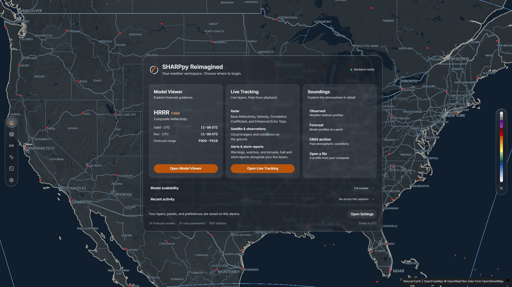](docs/images/v3.6.0/overview.jpg)

</details>

<details>
<summary><strong>Model Viewer · forecast fields and playback</strong></summary>

[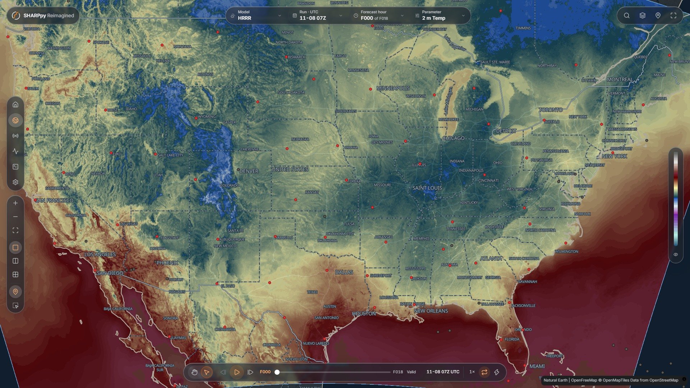](docs/images/v3.6.0/model-viewer.jpg)

</details>

<details>
<summary><strong>Two panels · synchronized forecast comparison</strong></summary>

[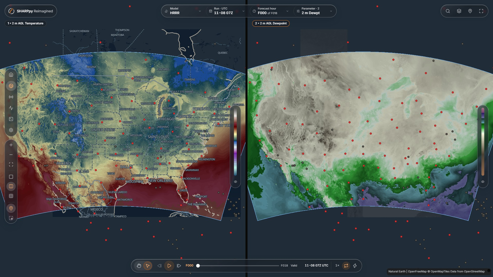](docs/images/v3.6.0/two-panels.jpg)

</details>

<details>
<summary><strong>Four panels · independent products and scales</strong></summary>

[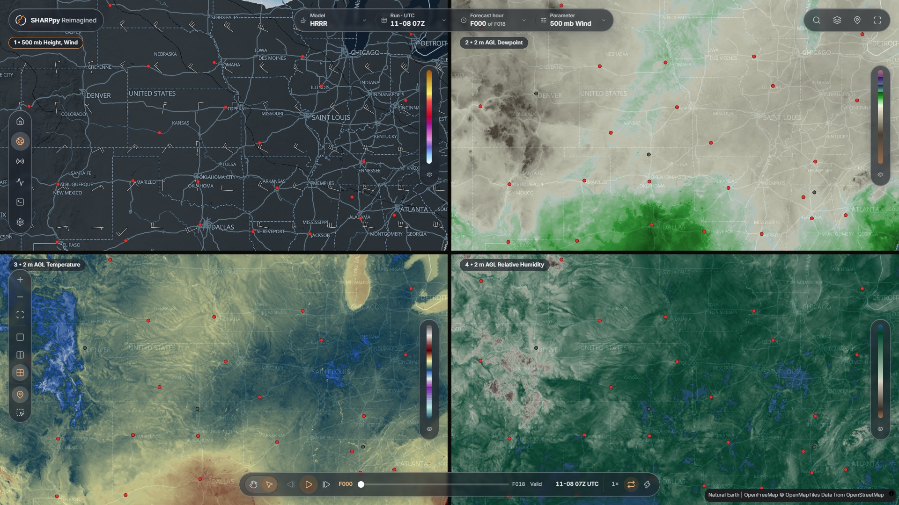](docs/images/v3.6.0/four-panels.jpg)

</details>

<details>
<summary><strong>Forecast downloads · saved hours and playback readiness</strong></summary>

[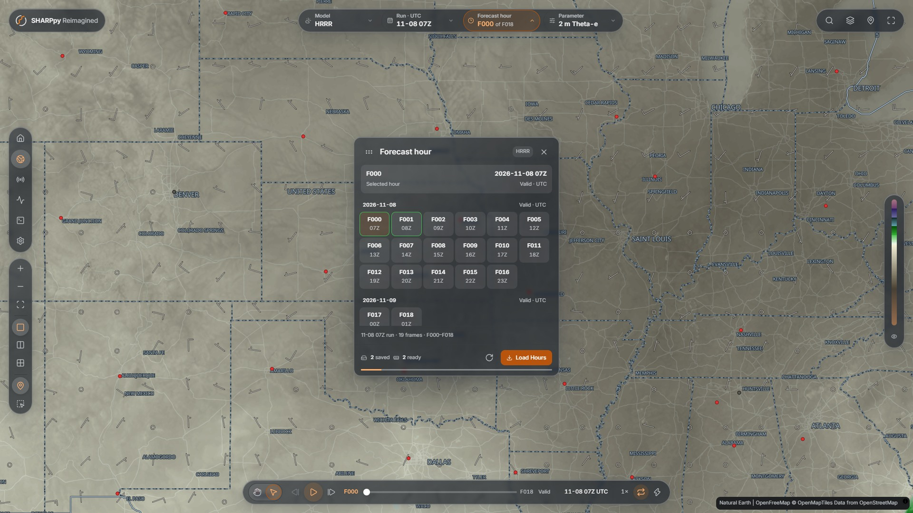](docs/images/v3.6.0/download-details.jpg)

</details>

<details>
<summary><strong>Live Tracking · radar products and measured values</strong></summary>

[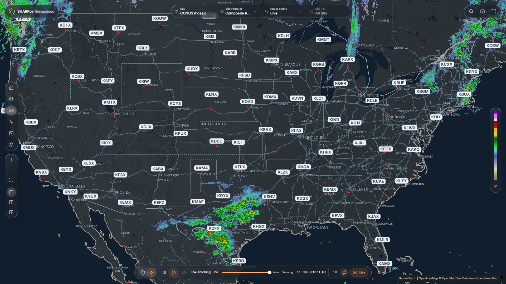](docs/images/v3.6.0/live-tracking.jpg)

</details>

<details>
<summary><strong>Soundings · Skew-T, hodograph and profile editing</strong></summary>

[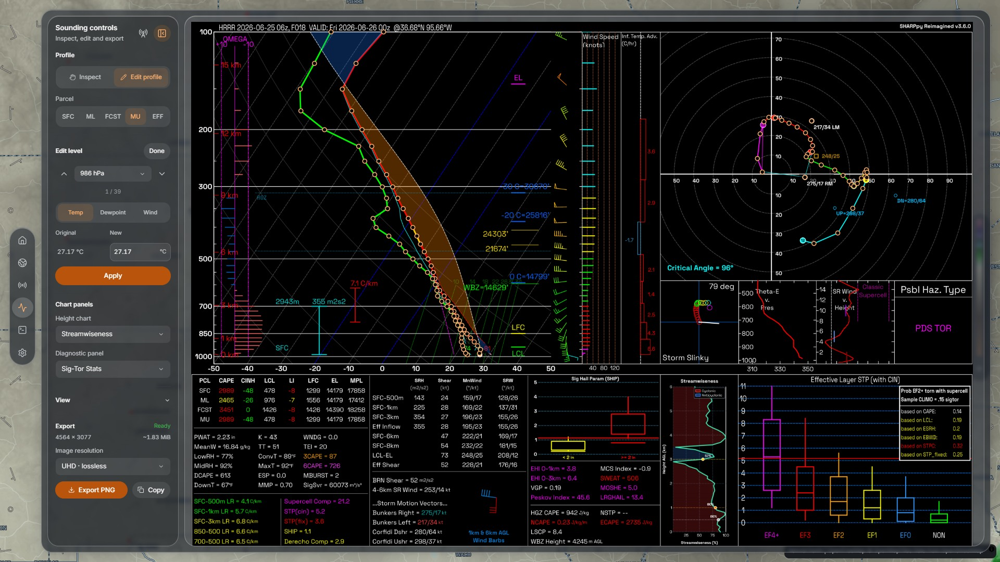](docs/images/v3.6.0/sounding.jpg)

</details>

<details>
<summary><strong>Box soundings · native grid columns and area means</strong></summary>

[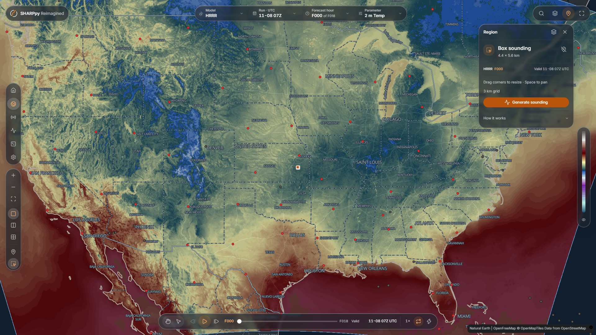](docs/images/v3.6.0/box-selection.jpg)

[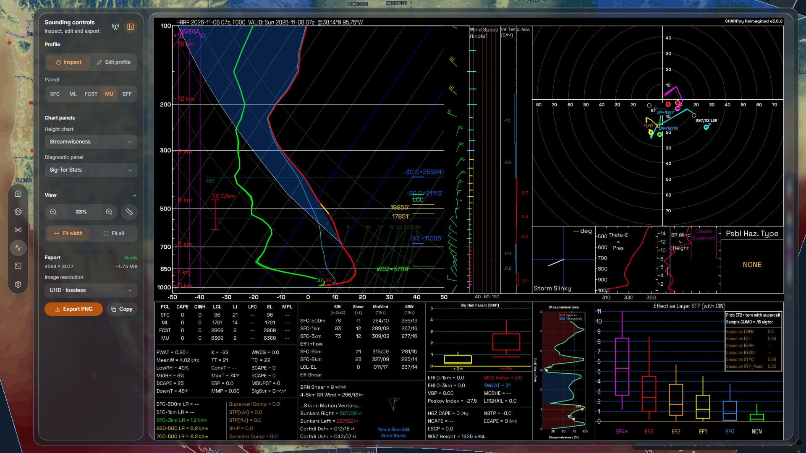](docs/images/v3.6.0/box-sounding.jpg)

</details>

<details>
<summary><strong>Settings · preferences and weather cache management</strong></summary>

[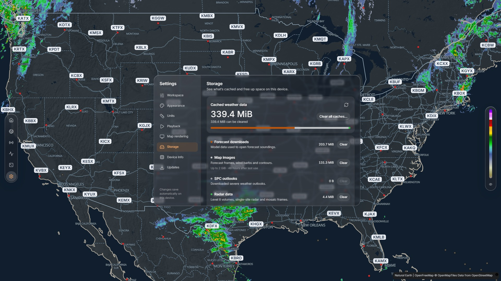](docs/images/v3.6.0/settings.jpg)

</details>

<details>
<summary><strong>Updates · release highlights</strong></summary>

[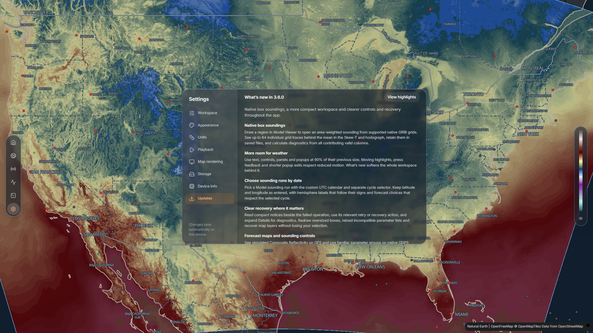](docs/images/v3.6.0/updates.jpg)

[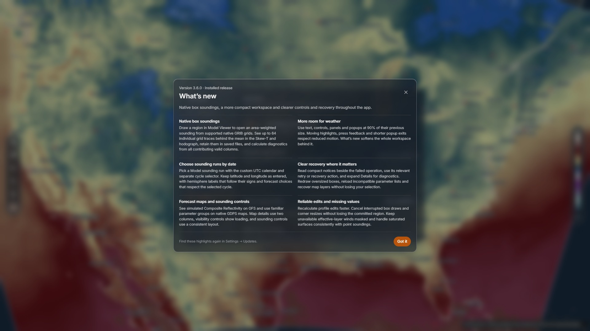](docs/images/v3.6.0/whats-new.jpg)

</details>

<details>
<summary><strong>Australian radar · native velocity and site selection</strong></summary>

[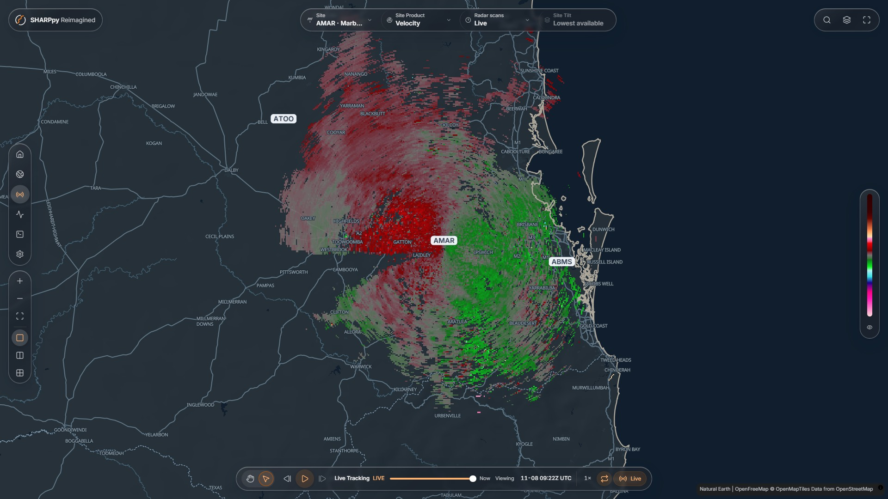](docs/images/v3.6.0/australian-radar.jpg)

</details>

## Get started

Windows installers and portable ZIPs are distributed through
[GitHub Releases](https://github.com/ShianMike/SHARPpy-Reimagined/releases).
Both include the analysis backend and Python. Extract the complete portable
folder before launching it. Existing installations can check **Settings →
Updates**. Release assets include checksums and build provenance; the Windows
executables are unsigned.

To run from source, use Python **3.11–3.13**, Node.js **24.12 or newer**, stable
Rust and your platform's Tauri prerequisites. From the repository root in
PowerShell:

```powershell
py -3.11 -m venv .venv
.\.venv\Scripts\Activate.ps1
python scripts/install_sharppy_compat.py --extras era5,wrf,rust-build
sharpmod-rust-sync
Set-Location frontend
npm ci
npm run tauri -- dev
```

For a live browser preview, run `npm run dev:browser` in `frontend/` and open
`http://127.0.0.1:5174/`. Use `npm run dev:fixture` for sample data.

## Documentation

- [Using the app and command-line tools](docs/USAGE.md)
- [Sounding parameter guide](docs/sounding_parameter_guide.md)
- [Historical interface screenshots](https://github.com/ShianMike/SHARPpy-Reimagined/tree/84056a2634ae53028b931c8728a8a7e8b97bc07c/docs/images)
- [Installation and optional dependencies](installation.txt)
- [Frontend development](docs/frontend/ARCHITECTURE.md)
- [Rust backend and Python fallback](docs/RUST_BACKEND.md)
- [Contributing and release checks](CONTRIBUTING.md)

SHARPpy Reimagined is a fork of [SHARPpy](https://github.com/sharppy/SHARPpy),
distributed under the [BSD 3-Clause License](LICENSE). Weather layers retain
their provider and valid-time information.
