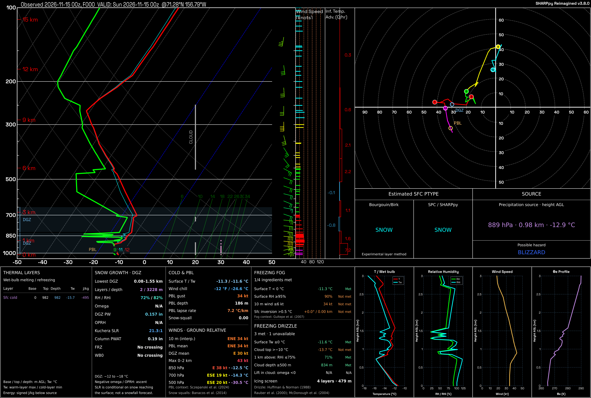

<div align="center">

# SHARPpy Reimagined · v3.8.4

**Forecast maps, live weather and sounding analysis in one desktop workspace.**

[](https://github.com/ShianMike/SHARPpy-Reimagined/actions/workflows/tests.yml)
[](https://github.com/ShianMike/SHARPpy-Reimagined/releases "Downloads of all release assets, including updater metadata")


[](LICENSE)

[Screenshots](#screenshots) · [Downloads](https://github.com/ShianMike/SHARPpy-Reimagined/releases) · [User guide](docs/USAGE.md) · [Changelog](CHANGELOG.md#v384---2026-11-17)

</div>

## What's new in 3.8.4

- **Restore your sounding session:** recover open profiles, completed edits,
  undo/redo history, selected times and the Severe or Winter view after an exit.
  Recovery copies stay on this device, separately from temporary weather data.
- **Faster forecast export setup:** remember quality, frame duration and panel
  scope. Keep all hour shortcuts in one row, select the next 6 or 12 hours,
  thin a selection to every 3 hours, or Shift-click a range.
- **Independent storm reports:** each panel keeps its own hazard filter and
  event window in Model Viewer and Live Tracking, including saved layouts.
- **Complete export overlays:** load enabled storm reports, SPC outlooks and
  isobars for every selected hour and panel before capturing PNG, GIF or WebP.
- **More reliable sounding images:** native request checks catch invalid edits
  before rendering. Rust manages imports and image-cache transactions, retries
  invalid cached images, and cleans up failed uploads and partial renders.
- **Faster forecast loading:** share decoded GRIB ingredients between parameters
  and panels, decode completed fields while other ranges download, and fetch
  required sounding companions alongside pressure data. Measured transfer
  history guides route, mirror and worker choices within existing limits.
- **Cleaner Windows upgrades:** remove obsolete installed runtime code and native
  packages while keeping current files, saved soundings, preferences and recovery
  sessions. Locked or unsafe runtime paths stop the installer with a clear error.

The [fixed-input GRIB comparison](benchmarks/results/2026-11-17-unreleased-grib-loading/README.md)
records exact numerical parity and less repeated transfer work. Its controlled
loading measurements are separate from Internet, PNG and GIF performance.

## Sounding and forecast tools

- **Winter soundings:** switch between Severe and Winter in the same sounding
  viewer. Winter adds precipitation type guidance, snow growth, icing and
  lower atmosphere profiles alongside the Skew-T and hodograph.
- **Forecast exports:** choose forecast hours and export the active panel or
  complete map layout. Save PNGs, looping GIFs or lossless animated WebPs.
  The color scale stays visible while hours load.
- **Sounding images for other apps:** the headless renderer exports Severe and
  Winter PNGs, with an optional JSON result for scripts and services. See the
  [integration guide](docs/SOUNDING_IMAGE_INTEGRATION.md).
- **More Rust calculations:** sounding height charts use native kernels through
  the existing interfaces.
- **Temporary-file recovery:** desktop shutdown retries locked session files,
  and a later launch recovers owned session files left by a process crash.
- **Dependency updates:** includes ecCodes 2.50.1, Ruff 0.17.4 and the
  action-gh-release 3.0.4 release workflow update.

## Weather analysis

- **Model Viewer:** compare forecast fields in one, two or four synchronized
  maps. Models are grouped into CONUS, Global and Regional, with RAP and RDPS
  under Regional. Parameter choices follow the selected run's published fields.
- **More model coverage:** explore supported GFS, ECMWF, ECMWF 9km, RRFS and REFS
  parameters. GDPS provides point soundings; AIGFS provides map analysis only.
- **Live Tracking:** follow radar, satellite imagery, surface observations,
  warnings and watches. Compare available radar products and tilts, inspect
  measured values and replay cached observations with their source times.
- **Soundings:** open observed, model or ERA5 profiles, or import local files.
  Inspect linked Skew-T and hodograph levels, edit a profile with undo/redo,
  and copy or export HD/UHD PNGs with edited-level annotations.

## Clearer controls

Find parameters by category or search, preview descriptions in a separate glass
card, and switch between navigation and point inspection beside playback.
Readable glass readouts follow saved temperature and wind units. Graphics
settings compare Automatic, Low, Balanced and High in one view.

Logs can copy a diagnostic summary with the operation, provider, time, error
category and recovery action, excluding credentials and raw request details.
Before an update installs, review open sounding work. Completed recovery copies
can restore profiles, edits and history after reopening the app.

## Screenshots

A Winter sounding from the Barrow, Alaska observed profile.
Open the image to inspect its full resolution.

[](docs/images/v3.8.0/winter-sounding.png)

## Get started

Windows installers and portable ZIPs are distributed through
[GitHub Releases](https://github.com/ShianMike/SHARPpy-Reimagined/releases).
Both include the analysis backend and Python. Extract the complete portable
folder before launching it. Existing installations can check **Settings →
Updates**. Release assets include checksums and build provenance; the Windows
executables are unsigned.

To run from source, use Python **3.11–3.13**, Node.js **24.12 or newer**, stable
Rust and your platform's Tauri prerequisites. From the repository root in
PowerShell:

```powershell
py -3.11 -m venv .venv
.\.venv\Scripts\Activate.ps1
python scripts/install_sharppy_compat.py --extras era5,wrf,rust-build
sharpmod-rust-sync
Set-Location frontend
npm ci
npm run tauri -- dev
```

For a live browser preview, run `npm run dev:browser` in `frontend/` and open
`http://127.0.0.1:5174/`. Use `npm run dev:fixture` for sample data.

## Documentation

- [Using the app and command-line tools](docs/USAGE.md)
- [Sounding parameter guide](docs/sounding_parameter_guide.md)
- [Installation and optional dependencies](installation.txt)
- [Frontend development](docs/frontend/ARCHITECTURE.md)
- [Rust backend and Python fallback](docs/RUST_BACKEND.md)
- [Contributing and release checks](CONTRIBUTING.md)

SHARPpy Reimagined is a fork of [SHARPpy](https://github.com/sharppy/SHARPpy),
distributed under the [BSD 3-Clause License](LICENSE). Weather layers retain
their provider and valid-time information.
