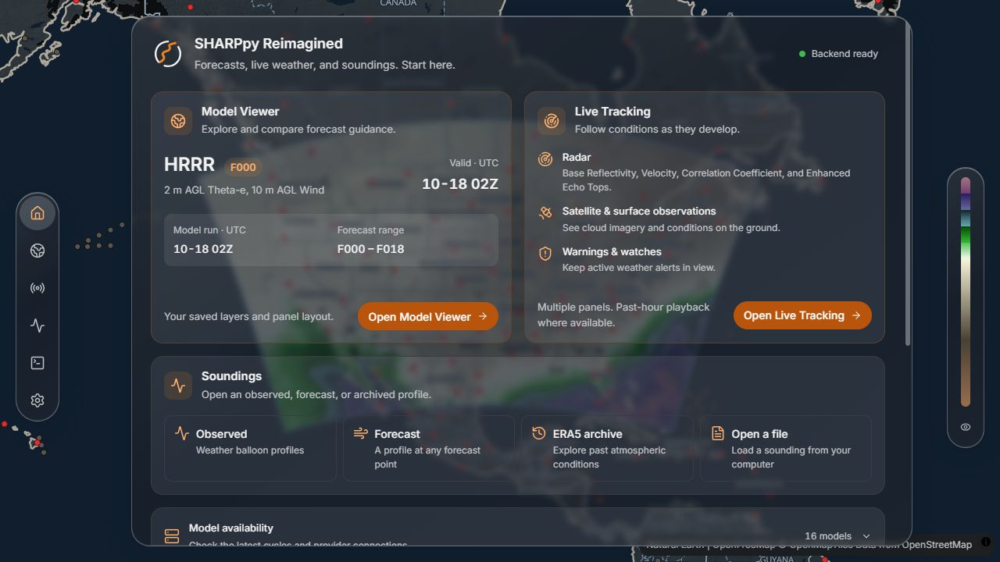
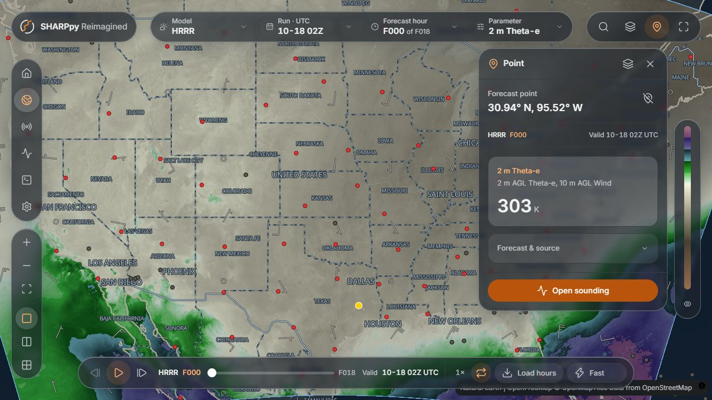
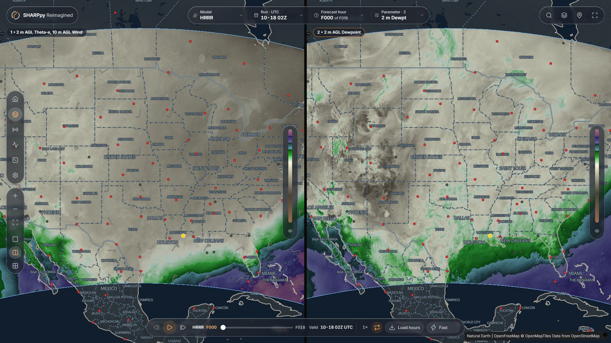
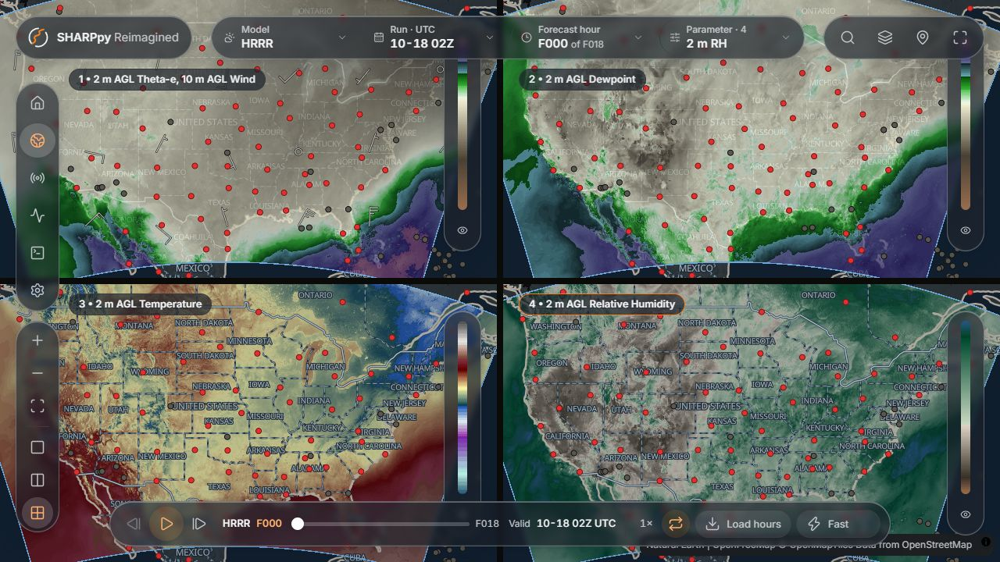
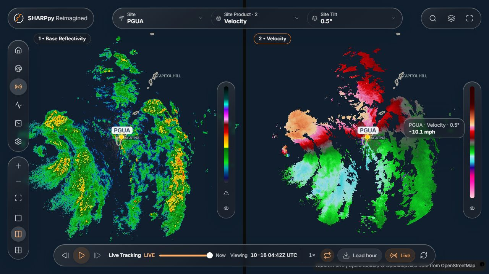
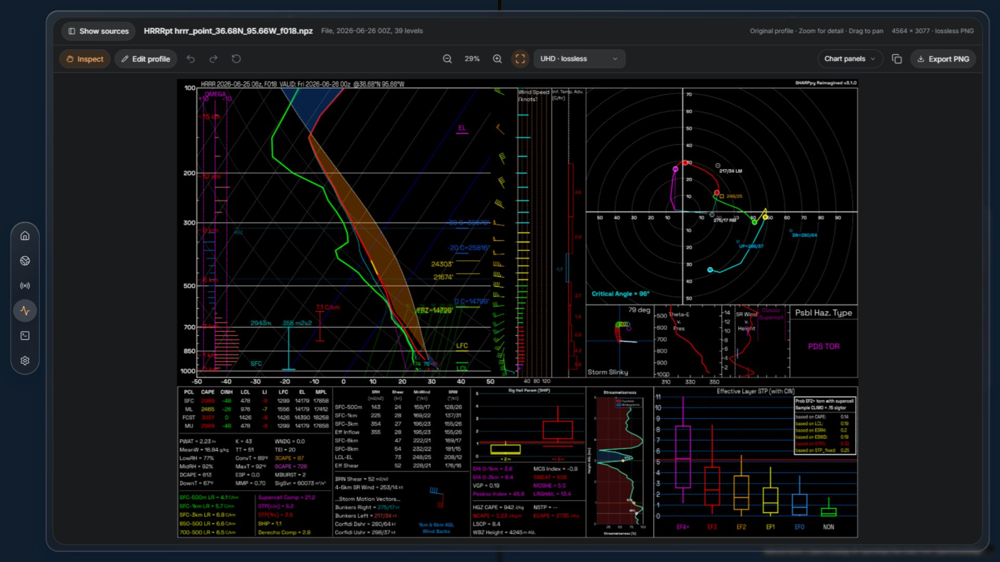
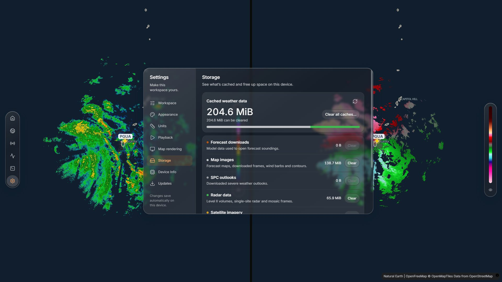

# SHARPpy Reimagined

**Severe-weather soundings, forecast fields, and live radar in one desktop workspace.**

[Explore the app](#explore-the-app) · [Get started](#get-started) · [User guide](docs/USAGE.md) · [Downloads](https://github.com/ShianMike/SHARPpy-Reimagined/releases)

## What's new in 3.1.0

SHARPpy Reimagined brings [SHARPpy](https://github.com/sharppy/SHARPpy) sounding analysis into a map-based desktop workspace. Version **3.0.0** introduces a React/Tauri interface backed by the existing Python and Rust scientific tools. This README describes that interface; the [v2.0.0 Legacy tour and screenshots](https://github.com/ShianMike/SHARPpy-Reimagined/blob/v2.0.0/README.md) document the previous GUI.

Version **3.1.0** adds **Live Tracking**, a dedicated workspace for native radar, satellite imagery, surface observations, and NWS warnings and watches. Compare independent radar products and tilts in synchronized panels, inspect measured values under the cursor, and cache the past hour for playback. Base Reflectivity and Correlation Coefficient share Level II volumes; Velocity and Enhanced Echo Tops use native Level III products. Live caches are bounded, visible in Storage settings, and removed when the app closes. Overview now opens at startup with direct paths to Model Viewer, Live Tracking, and soundings. See the [full v3.1.0 changelog](CHANGELOG.md#v310---2026-10-18).

The **3.0.2 patch** adds saved temperature and wind units, map rendering fixes, panel titles that open the parameter picker, cleaner Settings and Logs layouts, quicker model availability checks, and faster Windows release builds. It includes the **3.0.1** additions: signed in-app updates, a fullscreen control, a minimum window size of 1280 × 800, and clearer outlook tooltips and notices.

## Explore the app

Use the navigation rail to move between six workspaces:

| Workspace | What you can do |
| --- | --- |
| **Overview** | Start a forecast or sounding workflow and check the backend status. |
| **Model Viewer** | Explore forecast fields in one, two, or four synchronized maps; inspect a point and open its sounding. |
| **Live Tracking** | Follow radar, satellite, observations, warnings, and watches; compare products and tilts, inspect radar values, and play the past hour. |
| **Soundings** | Fetch observed, forecast-model, or ERA5 profiles, or import local files; inspect and edit the Skew-T and hodograph. |
| **Logs** | Inspect backend health, capabilities, and diagnostic messages when a request fails. |
| **Settings** | Choose units, appearance, playback and graphics; manage saved settings and cached data; check for updates. |

### v3.1.0 tour

These screenshots show the **current v3.1.0 interface**, captured from the running
live browser preview on **18 October 2026** at its native **1920 × 1080** viewport.
Click an image for its original pixels. Forecast maps use **HRRR 18 October 02Z,
F000**. Live Tracking shows actual **PGUA radar scans** from the capture session;
the imported sounding is the bundled **25 June 06Z, F018** case, valid **26 June
00Z**. [Capture details and data times](docs/images/v3.1.0/README.md).

<strong>Overview · forecast, live weather, and sounding workflows</strong>

Overview opens when the app starts. Resume your forecast setup, follow live
conditions, or open an observed, model, ERA5, or local-file sounding.

<strong>Model Viewer · forecast field and point inspector</strong>

Select a point to read its value and source, then open its sounding.

<strong>Two panels · surface Theta-e and dewpoint</strong>

Compare products at the same forecast time with synchronized map movement.

<strong>Four panels · independent products and scales</strong>

Each panel keeps its own layers and a scale positioned within that panel.

<strong>Live Tracking · native radar products and measured hover values</strong>

Compare products and available tilts while moving both maps together. Hover to
read the decoded radar data. Scan timestamps and delay indicators distinguish
the actual observation from the timeline's viewing time. Load the past hour
where the provider has data, then play the cached frames.

<strong>Soundings · local import, Skew-T, hodograph, and editing controls</strong>

The NPZ was imported through the File form and rendered at UHD resolution.
Inspect or edit the profile, then copy or export the image.

<strong>Settings · saved preferences and weather cache management</strong>

Preferences save on the current device. Storage reports forecast and live-data
caches separately; live data is removed when the app closes.

### Weather maps

Choose a model, UTC run, forecast hour, and parameter from the floating toolbar. The timeline steps through available forecast hours, with playback speed and looping controls. **Load hours** downloads the selected run's hours for the visible panels, including wind barbs and contours, with progress, stop and retry controls. **Fast** switches frames instantly; **Smooth** briefly blends their colours while point readings keep the actual hourly values. The playback choice is saved and respects reduced motion.

Two- and four-panel layouts share the map view and forecast time while keeping each panel's parameter, layers, and colour range. The layout, active panel, layer choices and model selection return between sessions, with the model opening on its latest suggested run. Hover over a model field to read its value; select a point for details and **Open sounding**.

Field rendering defaults to **Smooth**, with **Sharp** available to show grid cells; this choice is separate from Fast / Smooth playback. Station labels default off and retain your saved choice. Model Viewer layers include SPC outlooks and storm reports; radar, satellite imagery, surface observations, warnings, and watches are in Live Tracking. Wind barbs adapt their density to the zoom level. **Layers → Map details** offers a saved **Flat map / Globe** projection shared by all panels; Live Tracking uses a flat map.

New HRRR products include total precipitation, precipitation rates, precipitable water, snow depth, surface winds and gusts, effective storm-relative helicity, maximum updraft velocity, Surface-Based Lifted Index, and 2 m Theta-e with 10 m wind barbs. Model menus show only supported products for HRRR, NAM 3 km, RRFS and REFS members; the [changelog](CHANGELOG.md#v303---2026-10-17) details model limits and units.

**Settings → Storage** shows forecast-download, map-image and SPC-outlook cache usage, including preloaded forecast frames. Clear a category or all available caches while keeping saved files, open soundings, pinned data and active downloads. **Layers → Reset layers** restores layer options and the flat projection across panels; **Settings → Workspace** resets app preferences while keeping open work, cached data and the map location.

### Soundings and local imports

The **Soundings** workspace has **Obs.**, **Model**, **ERA5**, and **File** sources. Open NPZ point soundings, SPC, BUFKIT, PECAN, and UWyo text or saved HTML files up to **6 MiB**.

Station availability is checked automatically against the observed launch's UWyo list. Station details, hover tooltips and map markers share the result; failed checks keep the bundled station catalogue available and offer a retry.

For raw WRF-ARW output, choose **File → Import format → Raw WRF dataset**, paste the full local path to the `wrfout`/NetCDF file, and click **Read WRF file**. Select a UTC forecast time and a point within its grid, then **Open WRF sounding**. The dataset stays on disk while the backend extracts the selected column.

Use **Inspect** to pan and zoom the sounding, or **Edit profile** to change a selected level. Undo, redo, and reset let you review edits without overwriting the input file. Choose HD or UHD lossless output and copy or download the sounding image. See the [desktop guide](docs/USAGE.md#0-desktop-interface-v300) for the full workflow.

## Get started

### Windows downloads

Download the **v3.0.3 [Windows installer](https://github.com/ShianMike/SHARPpy-Reimagined/releases/download/v3.0.3/SHARPpy-Reimagined-v3.0.3-windows-x64-setup.exe)** or the [portable ZIP](https://github.com/ShianMike/SHARPpy-Reimagined/releases/download/v3.0.3/SHARPpy-Reimagined-v3.0.3-windows-x64.zip). Both include the app and its analysis backend; Python is bundled. Extract the complete portable folder before running the app. The executables are unsigned; [release notes, checksums, and build provenance](https://github.com/ShianMike/SHARPpy-Reimagined/releases/tag/v3.0.3) let you verify the download. Existing v3.0.1 and v3.0.2 installations can use **Settings → Updates**.

**v2.0.0 Legacy is the final PySide6/Qt GUI release.** Its [Windows ZIP](https://github.com/ShianMike/SHARPpy-Reimagined/releases/download/v2.0.0/SHARPpy-Reimagined-v2.0.0-windows-x64.zip) and [portable executable](https://github.com/ShianMike/SHARPpy-Reimagined/releases/download/v2.0.0/SHARPpy-Reimagined-v2.0.0-windows-x64-portable.exe) remain downloadable from the [legacy release page](https://github.com/ShianMike/SHARPpy-Reimagined/releases/tag/v2.0.0), including after v3 is released.

### Run v3 from source

Use Python **3.11–3.13**, Node.js **24.12 or newer**, a stable Rust toolchain, and your platform's Tauri build prerequisites. On Windows, run these commands from the repository root in PowerShell:

~~~powershell
py -3.11 -m venv .venv
.\.venv\Scripts\Activate.ps1
python scripts/install_sharppy_compat.py --extras era5,wrf,rust-build
sharpmod-rust-sync
Set-Location frontend
npm ci
npm run tauri -- dev
~~~

The compatibility installer verifies and installs the upstream SHARPpy render wheel. `sharpmod-rust-sync` builds the native scientific extension when needed. The development app discovers the repository's `.gribenv` or `.venv`; an explicit `SHARPPY_PYTHON` must be an absolute interpreter path.

For a live browser preview, run `npm run dev:browser` from `frontend/` and open `http://127.0.0.1:5174/`. For deterministic sample data, use `npm run dev:fixture` instead. See the [development guide](docs/frontend/ARCHITECTURE.md#running-the-interface) and [installation reference](installation.txt) for prerequisites and troubleshooting.

To render a saved sounding without the desktop, run:

~~~powershell
sharpmod-render examples/soundings/hrrr_point_36.68N_95.66W_f018.npz sounding.png
~~~

The legacy Qt interface and `sharpmod-gui` entry point are retired from the current source tree. Use the [v2.0.0 Legacy release](https://github.com/ShianMike/SHARPpy-Reimagined/releases/tag/v2.0.0) for that interface. Start the current interface with the Tauri command above; Qt remains part of its headless sounding renderer.

## Guides

- [Using the v3 desktop, local imports, and CLI](docs/USAGE.md)
- [Frontend development and architecture](docs/frontend/ARCHITECTURE.md)
- [Frontend commands and data contracts](docs/frontend/DATA_CONTRACTS.md)
- [Installation and optional dependencies](installation.txt)
- [Rust backend and Python fallback](docs/RUST_BACKEND.md)
- [Changes in 3.0.3](CHANGELOG.md#v303---2026-10-17)
- [Contributing and test lanes](CONTRIBUTING.md)
- [v2.0.0 Legacy usage guide](https://github.com/ShianMike/SHARPpy-Reimagined/blob/v2.0.0/docs/USAGE.md)

SHARPpy Reimagined is a fork of [SHARPpy](https://github.com/sharppy/SHARPpy) and is distributed under the [BSD 3-Clause License](LICENSE). Weather layers retain their provider and valid-time information in the interface.
